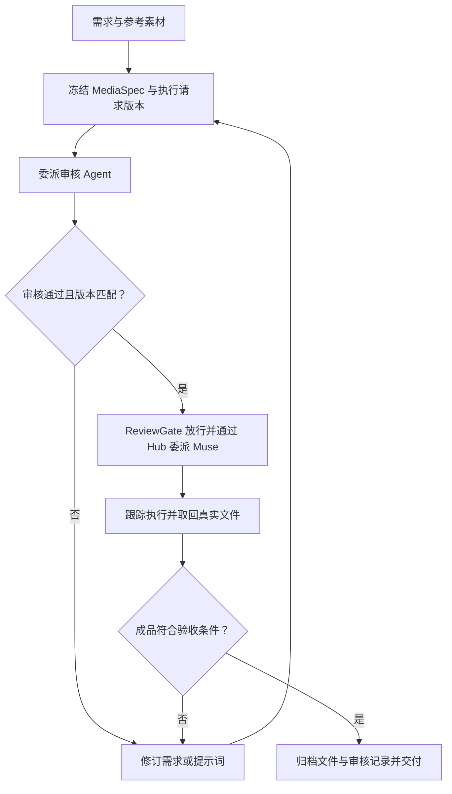

# Agent Hub + MediaFlow：双项目开发规格与 Codex 执行说明

版本：1.0｜讨论定稿：2026-10-11｜文档类型：架构决策、接口约定、实施任务与验收标准

> 本文是本次讨论的最终结论，替代此前“将媒体业务直接放进 Agent Hub”的方案。
> 保留现有 Agent Hub，新增独立的 MediaFlow 项目，通过一个统一的 HubGateway 接口连接。
> 当前总控为 Codex，Muse 是首版唯一媒体生成执行器；审核 Agent 先审核，通过后才下发生成。GLM 暂不加入首版。

## 1. 给开发 Codex 的任务

请根据本文开发两个独立项目之间的多媒体工作流集成：

1. 在现有 `AllenLQJ/AI-Integration-platform` 中核实和补齐通用任务、能力查询及附件获取接口。
2. 新建独立项目 `media-flow`（暂定名称），实现图片、视频的需求整理、提示词/分镜、审核门禁、生成编排、成品复核和交付。
3. 所有跨项目调用经过 `HubGateway v1`；首版优先复用 Agent Hub 已有 MCP 接口。
4. 先完成图片闭环；视频能力验证成功后，继续完成视频闭环。未验证能力必须明确报告，不能把模拟结果当真实集成完成。

先检查实际仓库与项目指引，再制定短计划并开始实现。本文没有声称已读取或验证仓库当前源码；此前讨论提到的 Python、MCP、SQLite、Muse delegate 和任务生命周期是待开发 Codex 核查的背景，不应替代源码证据。当前仓库实现、工具名、目录和测试命令以实际文件为准。

本次交付物是开发规格，不代表上述功能已经实现。

## 2. 最终架构决策

### 2.1 两个独立项目

| 项目 | 定位 | 应拥有的内容 |
|---|---|---|
| Agent Hub | 通用 Agent 协作与执行基础设施 | Agent 适配器、任务委派、能力查询、执行状态、并发、取消、执行重试、任务事件、附件来源与传输 |
| MediaFlow | 图片与视频业务工作流 | 媒体需求、提示词、分镜、参考素材、审核政策、生成版本、质量复核、返工、成品归档、可复用 Skills |

两个项目分别拥有 Git 仓库、依赖、配置、测试和本地运行数据。首版可以运行在同一台电脑，不要求引入分布式部署或容器平台。

选择拆分的原因：媒体业务有独立的流程和数据模型，未来会持续增加分镜、角色一致性、镜头连续性、素材管理等能力；Agent Hub 则要保持对各种 Agent 任务的通用支持。拆分后，媒体流程可以独立演进，未来由其他 Agent 接手总控时仍复用同一套规则与接口。

### 2.2 一个统一连接边界

“一个接口”指一个版本化的逻辑接口 `HubGateway`，不要求把所有操作硬塞进一个 RPC 方法。

- Agent Hub 是执行服务端。
- MediaFlow 内的 `HubGateway` 是唯一跨项目调用入口，隐藏 MCP 工具名、连接方式和返回格式的差异。
- 首版通过已有 MCP 服务连接，不同时实现多套 HTTP、MCP 和直连数据库路径。
- MediaFlow 不导入 Hub 内部 Python 模块，不访问 Hub 的 SQLite，不读取 Hub 的运行状态文件。
- 两项目通过接口契约连接；若未来增加远程传输，只替换 gateway 实现，媒体业务流程保持使用同一契约。
- 无需新增一个单独运行的“网关服务”。首版 gateway 是 MediaFlow 中的客户端模块。

Agent Hub 负责“执行一次被委派的任务”；MediaFlow 负责“决定现在应该审核、生成、返工还是交付”。

## 3. Agent 角色与更换总控

| 角色 | 首版选择 | 职责 |
|---|---|---|
| 总控 Agent | Codex | 理解目标，形成计划，推进工作流，处理异常并汇报结果；不直接生成图片或视频 |
| 提示词/需求审核 Agent | 已可调用的 DeepSeek 或 Claude Code 等 | 检查提示词、参数、参考素材说明与验收条件是否一致、可执行 |
| 视觉审核 Agent | 经能力验证的可用 Agent | 检查参考图、成品图片或视频；文本能力不等于视觉/视频能力 |
| 生成 Agent | Muse | 执行图片/视频生成或编辑，返回可追踪状态与实际产物 |
| 后续备选 | GLM | 保留扩展空间，首版不接入路由、审核或生成链路 |

工作流规则、schema、审核政策和 Skill 内容属于 MediaFlow，不仅存在于 Codex 的聊天记录或个人记忆中。其他总控 Agent 应能通过同一 CLI/工具接口读取任务、推进流程和恢复工作。

配置可包含 `controller_agent`、`prompt_reviewer_agent`、`visual_reviewer_agent` 和 `generator_agent`；首版 `generator_agent` 固定配置为 Muse。更换总控不等于开放任意生成器。

Hub 中的 Codex worker 与媒体总控是不同角色。禁止由于路由配置错误，让当前 Codex 总控递归委派给自身并重复启动工作流。

## 4. 项目职责边界

| 能力/规则 | 归属 | 说明 |
|---|---|---|
| 任务提交、查询、取消、幂等 | Agent Hub | 所有 Agent 可共用 |
| Agent 可用性、调用能力、附件传输 | Agent Hub | 连接器级事实，不包含媒体审核政策 |
| 运行超时、交付确认、执行重试 | Agent Hub | MediaFlow 不另外维护第二套底层任务队列 |
| MediaSpec、提示词、分镜 | MediaFlow | 媒体业务数据 |
| 审核通过后才生成 | MediaFlow | 由 ReviewGate 强制执行 |
| 生成失败后是否改需求再试 | MediaFlow | 业务判断；底层执行恢复仍通过 Hub |
| 成品质量不合格后的返工 | MediaFlow | 新版本、审核、再次生成 |
| 最终成品归档和交付清单 | MediaFlow | Hub 可暂存源附件，MediaFlow 拥有最终交付副本 |

Hub 对普通任务 payload 做传输与通用校验，不承担 MediaSpec 解析、分镜编排或媒体质量判定。必要的 Muse 协议/登录/会话处理放在已有 Muse 适配器；如何把 MediaSpec 编译成最终提示词和参考素材包放在 MediaFlow。

## 5. 媒体工作流



图片工作流至少覆盖：需求 → 提示词 → 审核 → Muse 生成 → 文件取回 → 复核 → 交付。

视频工作流在需要时增加分镜、镜头顺序、时长、角色/风格连续性和参考帧。不能假定 Muse 支持所有参数、首尾帧控制或分镜批量执行；按验证结果开放能力。

提示词审核必须在首次生成前完成。生成后复核应记录明确结论；如果没有适用的视觉/视频审核能力，标记等待人工复核或能力受限，不能自动填写“已通过视觉审核”。视频抽帧检查与检查完整视频是不同能力，必须说明实际覆盖范围。

## 6. HubGateway v1 契约

以下是 MediaFlow 对接口的要求，方法名是 gateway 内部契约，不代表 Hub 已存在同名 MCP 工具。优先映射现有工具，仅补齐确实缺失的通用能力。

### 6.1 最小操作集

| 操作 | 输入 | 输出 | 用途 |
|---|---|---|---|
| `get_capabilities` | 可选 Agent 筛选 | Agent、可委派任务、输入/输出、状态/附件能力 | 检查真实能力和阻塞项 |
| `submit_task` | 目标 Agent、任务 payload、关联信息、幂等键 | Hub task ID、当前执行状态 | 提交审核或生成任务 |
| `get_task` | Hub task ID | 状态、结构化结果、错误、附件描述 | 首版采用轮询查询 |
| `cancel_task` | Hub task ID、原因 | 取消请求/实际结果 | 区分请求取消与确认取消 |
| `get_artifact` | artifact ID | 经授权的取回描述 | 将文件流或本机文件取回 MediaFlow |

接口返回 `contract_version: "1.0"`。MediaFlow 对缺失必需字段、未知状态和不兼容主版本返回明确错误；不把未知状态默认映射成成功。

### 6.2 任务请求示例

```json
{
  "contract_version": "1.0",
  "target_agent": "muse",
  "task_kind": "delegate",
  "correlation": {
    "client_project": "media-flow",
    "workflow_id": "<MediaFlow 生成的 ID>",
    "step_id": "generation",
    "spec_revision": 3,
    "attempt": 1
  },
  "idempotency_key": "<稳定幂等键>",
  "payload": {
    "instruction": "<冻结且已审核的最终执行文本>",
    "attachments": ["<参考素材描述或已验证的附件引用>"],
    "requested_output": {"media_type": "image"}
  }
}
```

示例 ID 和字段值是占位符，真实 ID 由相应项目生成。附件传递格式由核实后的 Muse 能力决定；不能把 MediaFlow 本地路径直接当成 Muse 可访问的文件地址。

审核任务使用同一提交接口，payload 包含审核材料、审核政策和约定的结构化输出 schema。Hub 将结果原样传回；MediaFlow 负责解析并作业务判断。

### 6.3 执行状态与业务状态分开

Hub 统一输出：`queued`、`submitted`、`running`、`succeeded`、`failed`、`cancelled`。如果实际接口不同，由 gateway 映射并保留原始状态。

- `submitted`：已被目标 Agent 接收，不代表生成完成。
- `succeeded`：连接器获得明确执行完成证据；MediaFlow 仍须验证文件和成品质量。
- 只获得发送成功时，不能填 `succeeded`。
- 远端是否接收不确定时，返回可辨识的 `delivery_unknown` 错误/标记，先查证，不盲目重复提交。
- 取消失败或尚未确认时，保留实际状态和取消请求记录，不能直接声称已取消。

MediaFlow 自己维护：`draft`、`review_pending`、`revision_required`、`ready_to_generate`、`generating`、`collecting`、`quality_review_pending`、`ready_to_deliver`、`delivered`，以及失败/取消状态。每次转移记录原因、操作者、时间、相关 Hub task ID 与版本。

### 6.4 幂等、恢复和错误

- 每个工作流步骤/版本/执行 attempt 有稳定幂等键。同键同内容返回同一任务；同键不同内容返回冲突。
- MediaFlow 在调用前持久化提交意图；提交结果丢失后用相同幂等键恢复，避免重复生成。
- 重新生成的有意新 attempt 使用新幂等键，并关联原 attempt。
- 通信重连不等于重新执行生成任务；执行重试规则由 Hub 暴露且必须明确，避免两层重试叠加。
- 支持可配置的最大等待时间、最大生成次数和返工次数；耗尽后停止自动推进并报告原因。
- 错误至少包含 `code`、`message`、`retryable`、可选 `details`；日志中不包含密钥、Cookie 或带凭证的下载 URL。

### 6.5 附件与文件传输

附件描述至少包含 `artifact_id`、关联 Hub task ID、文件名、MIME 类型、文件大小和可选 SHA-256。附件 ID 应能稳定对应取回操作。

- MCP JSON 不承载整段大型 MP4 的 Base64 数据；返回传输描述，通过流式下载或已授权的本机文件复制取回。
- 首版本机方案可用 Hub 暂存文件路径，但必须明确双方运行在同一主机，并限制到约定的产物目录；跨设备不得复用该绝对路径。
- 远端临时链接只作为传输手段。MediaFlow 下载并验证后，登记自己的持久副本。
- MediaFlow 下载中使用临时文件，验证完成后再原子移动到成品目录。校验 MIME/文件签名、大小和可读取性；视频核实容器、时长等实际元数据。
- 文件缺失、下载失败、损坏或格式不符时，工作流停在收集/失败状态，不进入交付完成。

## 7. MediaFlow 数据模型与审核门禁

### 7.1 核心实体

| 实体 | 必需信息 |
|---|---|
| Workflow | ID、目标、当前状态、controller、创建/更新时间、当前版本 |
| MediaSpecVersion | 不可变版本号、媒体类型、动作、提示词、参考素材、参数、风格约束、验收条件 |
| ExecutionRequest | 实际发送给 Muse 的冻结文本、附件引用/哈希、生成参数、内容指纹 |
| ReviewRecord | 审核任务 ID、审核 Agent、结论、问题列表、绑定的执行请求指纹和审核政策版本 |
| StepAttempt | 步骤、attempt、幂等键、Hub task ID、状态和错误 |
| Artifact | 来源任务/版本、MIME、大小、校验值、MediaFlow 本地保存位置、复核结论 |
| WorkflowEvent | 单调序号、状态变更、时间、原因、相关对象 |

MediaFlow 使用自己的本地 SQLite 持久化业务状态，文件保存在自己的数据目录。Hub 的数据库由 Hub 独立管理。

`MediaSpec` 的图片字段包括宽高/比例、格式、数量等；视频字段包括时长、分辨率、可选帧率和分镜。按已验证能力校验，不能静默丢弃 Muse 不支持的参数。

### 7.2 ReviewGate 位于 MediaFlow

门禁在 MediaFlow 的受控生成提交函数中执行，不能只依赖 Skill 提醒或 Codex 的口头判断。

1. 将实际执行请求按确定的规范序列化并计算 SHA-256。
2. 指纹覆盖最终执行文本、关键参数、参考素材内容哈希/版本和验收约束；编译器或政策改变时按版本规则重新审核。
3. 审核结果来自可追踪的真实审核任务。解析为约定 schema，确认其绑定版本；缺失/模糊/解析失败不能算通过。
4. 只有所有必需审核通过，且当前执行请求与审核指纹一致，才允许 `dispatch_generation` 调用 HubGateway。
5. 修改提示词、参数或参考素材后建立新版本，旧审核自动失效。
6. 状态转移和提交意图使用事务/版本检查；并发控制避免两个总控为同一步重复放行。

MediaFlow 的正常生成路径必须经过此门禁。Agent Hub 的通用任务接口本身不变成全局媒体审核系统；其他独立客户端调用 Hub 不属于 MediaFlow 工作流。未来若要强制所有客户端执行审核，应单独设计通用的调用权限/政策机制。

成品不合格后，保存复核意见；修改执行内容则重新审核。仅对完全相同请求进行有界执行重试时，可按明确政策复用仍有效的审核记录。

## 8. 可复用 Skills

首版在 MediaFlow 中沉淀以下 Skill 内容和模板，再按实际总控 Agent 的 Skill 约定提供安装方式：

| Skill | 输入 | 输出 |
|---|---|---|
| `media-brief` | 用户需求、参考素材 | MediaSpec 草稿和验收条件 |
| `image-prompt` | 图片 MediaSpec | 可冻结、可审核的图片执行请求 |
| `video-storyboard` | 视频需求、素材 | 镜头序列、时长、运动、连续性要求和提示词 |
| `media-review` | 待审核请求或成品 | 结构化审核结论、缺陷、修改建议 |
| `media-delivery` | 已通过复核的 artifact | 成品清单、参数、来源和交付摘要 |

Skills 提供流程知识；运行中的 MediaFlow 负责版本、门禁和状态。更换 Codex 后，新总控可以使用相同内容和 CLI/工具，避免依赖专有聊天上下文。

本规格中的 Skill 名称是拟开发模块，不宣称是热门开源项目。复用社区 Skill/MCP 时，记录来源、许可证、实际调用方式、维护情况、Star 数及查询日期；不要编造数字，也不要仅凭 Star 判断适合本项目。此候选评估不应阻塞使用已有能力的最小闭环。

## 9. 建议目录与运行方式

### 9.1 两个仓库

```text
AI-Integration-platform/   # 现有 Hub；沿用实际目录结构
media-flow/                # 新建独立 Git 仓库
  src/media_flow/
    domain/                # MediaSpec、审核记录、状态机
    workflows/             # 图片/视频步骤、返工策略
    gateways/              # HubGateway 契约及 MCP 实现
    storage/               # MediaFlow 自有数据库和 artifact 管理
    cli/                   # 各总控 Agent 共用的操作入口
  skills/                  # 可复用流程知识和模板
  contracts/               # JSON Schema、协议示例
  tests/                   # 契约、状态机与集成验证
  docs/
  config.example.*
  AGENTS.md
  README.md
```

此结构是建议，按实际 Python 工具链调整。不要在 Hub 内嵌套新项目的 `.git`，不要把 Hub 源码复制进新项目，也不需要首版创建第三个共享代码仓库。

### 9.2 最小用户/Agent 操作入口

首版提供可脚本调用且支持 JSON 输出的 CLI：创建工作流、查看/编辑草稿、请求审核、提交已审核生成、查询状态、获取成品、提交复核、修订、取消和恢复。所有生成命令经过 ReviewGate，禁止 CLI 参数直接跳过审核。

CLI 由 Codex 总控调用；其他 Agent 后续可通过同一入口接手。MediaFlow 自身的 MCP 外观接口可在确有需要时增加，不作为首版两项目连接的前置要求。

### 9.3 Windows 与 macOS

两台电脑分别运行各自的 Hub、MediaFlow 和总控 Agent，Git 同步代码、Skills 和配置模板。凭证、数据库、锁文件、会话、日志和生成文件不通过 Git 同步。

不要硬编码盘符、用户目录或 shell。通过配置指定 Hub MCP 启动命令、Agent 标识和数据目录。首版不要求跨电脑共享正在运行的工作流；跨设备接管需要可迁移素材、状态导出和路径重映射，作为后续能力单独实现。

## 10. 实施顺序与交付

### 阶段 0：核查现有 Hub 与 Muse

- 阅读 README、AGENTS.md、MCP 工具定义、Muse 适配器、任务持久化及相关测试。
- 列出现有工具到 HubGateway v1 的映射、必需缺口和最小修改。
- 验证 Muse 图片/视频生成、参考素材输入、编辑、状态查询、附件回传和下载分别是否可用。
- 验证审核 Agent 实际可调用的文本、视觉/视频能力。DeepSeek 接在 Claude Code 运行器后时，记录实际模型能力，不凭运行器名称判断。
- 区分“已验证”“有接口但未验证”“不支持”。输出短实施计划，随后实现不依赖缺失外部权限的部分。

### 阶段 1：接口与 MediaFlow 骨架

- 补齐 Hub 的必要通用能力，保持兼容现有客户端。
- 在独立新仓库实现 HubGateway、业务 schema、本地持久化、状态机与 CLI。
- 提供 fake gateway 用于开发与确定性验证；在文档中明确它不是 Muse 实际集成。

### 阶段 2：真实图片闭环

- 实现需求/提示词冻结、审核任务、结构化结果解析和 ReviewGate。
- 审核通过后委派 Muse，可靠追踪状态并取回实际图片。
- 完成成品复核、失败/返工和交付清单。
- 运行一个经授权的最小真实任务，记录真实路径/状态/文件证据；账号或通道不可用时报告具体阻塞，同时完成契约与本地验证。

### 阶段 3：视频闭环与总控可替换

- 按 Muse 已验证能力实现视频/分镜 schema 和执行编译。
- 取回真实视频并验证元数据；记录实际复核覆盖范围。
- 提供带结构化上下文的工作流交接包：目标、当前版本、状态、审核、Hub task IDs、产物和下一动作。
- 验证新启动的总控实例仅凭项目状态与交接信息恢复流程，不依赖原聊天上下文。

### 阶段 4：后续扩展

按实际需要增加批量、多镜头一致性、远程 Hub、跨设备接管、可视界面及新 Agent。GLM 接入须作为后续明确任务，不自动加入首版。

## 11. 验收标准

| 项目 | 必须验证的结果 |
|---|---|
| 项目独立性 | 两个独立仓库；MediaFlow 仅经 gateway 调用 Hub，未访问其数据库或内部模块 |
| 接口兼容 | gateway 映射实际工具；对不兼容版本、错误及未知状态有明确处理 |
| 审核门禁 | 无审核、拒绝、解析失败、版本变化、参考素材变化均不能下发生成 |
| 实际完成状态 | 发送成功不等于执行成功；执行成功不等于文件通过复核并交付 |
| 幂等与恢复 | 提交响应丢失和重启不会重复生成；同键不同请求被拒绝 |
| 并发与取消 | 同一步不会被双重放行；请求取消与确认取消可区分 |
| 文件真实性 | 实际取回有效 PNG/JPG/MP4；损坏、失效链接、缺失文件不被登记为完成 |
| 返工 | 缺陷与新版本关联；修改内容后旧审核失效；次数上限有效 |
| Agent 可替换 | 总控配置可变；新实例读取相同项目状态并继续；生成器首版仍为 Muse |
| 兼容性 | Hub 相关既有测试通过；MediaFlow 的核心契约与状态转移验证通过 |
| 能力诚实性 | 不把 fake gateway、未验证视频能力或文本审核说成真实媒体/视觉验证 |
| 运行资料 | 两仓库分别提供配置模板、启动说明、使用例、限制及集成测试结果 |

测试应覆盖实际风险：门禁、并发状态转移、幂等、断线恢复、文件收集和版本一致性。无需为了数量编写仅复述实现的测试。真实生成次数保持有界，避免测试意外重复消耗生成额度。

## 12. Codex 完成后的汇报格式

1. 两个项目分别修改/新增了什么，以及为什么。
2. HubGateway 实际使用哪些 MCP 工具，补齐了哪些能力。
3. 哪些图片/视频/审核能力已验证，证据与结果是什么。
4. 已运行的测试、通过/失败结果，以及真实集成是否完成。
5. 两项目的启动方法和一个可运行的图片流程示例。
6. 仍未解决的阻塞项、视频限制和接下来需要的具体条件。

## 13. 可直接复制给 Codex 的开发指令

> 请阅读本规格，在现有 `AllenLQJ/AI-Integration-platform` 和一个独立新建的 `media-flow` 仓库之间实现多媒体工作流。先核查源码、项目指引、现有 MCP 工具和 Muse 实际能力，给出简短计划后推进开发。Agent Hub 管理通用 Agent 任务；MediaFlow 定义并推进图片/视频业务流程，两者只通过 HubGateway v1 连接，首版优先用已有 MCP。Codex 是首任总控且不生成媒体；生成前由可用审核 Agent 审核，MediaFlow 的 ReviewGate 校验实际执行请求版本，通过后才经 Hub 委派 Muse。Muse 是首版唯一生成器，GLM 暂不加入。实现持久化、状态恢复、幂等、真实文件回收、成品复核和有限返工；先完成图片，再按验证结果完成视频。未来其他总控 Agent 应能读取相同状态与 Skills 接手。完成代码、文档和必要验证，分别汇报两个项目的改动、接口、测试、真实集成结果及阻塞。尚未验证的能力不能被标记为已完成。
